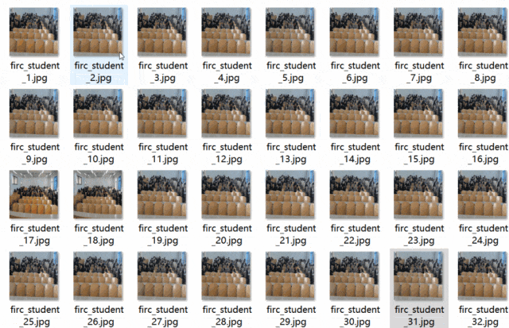
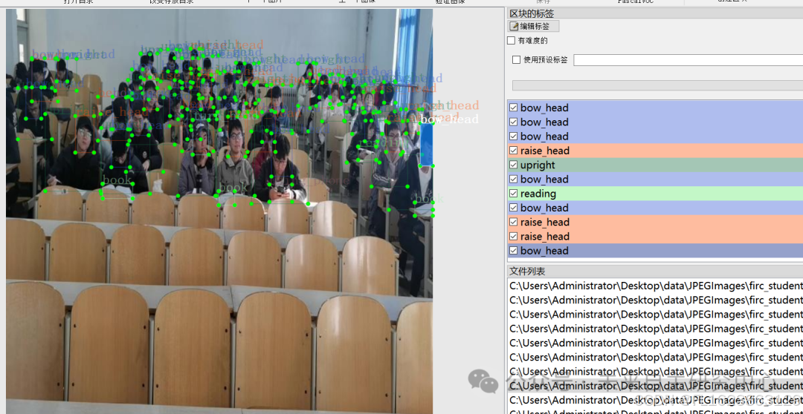

# [Dataset] [Object Detection] Classroom Walking Behavior Detection Dataset VOC+YOLO format with 4065 images in 12 categories

Dataset format: Pascal VOC format + YOLO format (txt files without split paths, only containing jpg images and corresponding VOC format xml files and yolo format txt files)
Number of images (jpg file count): 4065
Number of annotations (xml file count): 4065
Number of annotations (txt file count): 4065
Number of annotation categories: 12
Annotation category names: ["Using_phone", "bend", "book", "bow_head", "hand-raising", "phone", "raise_head", "reading", "sleep", "turn_head", "upright", "writing"]
Number of boxes per category:
Using_phone boxes = 12912
bend boxes = 11487
book boxes = 16985
bow_head boxes = 37382
hand-raising boxes = 3374
phone boxes = 5070
raise_head boxes = 11615
reading boxes = 8947
sleep boxes = 1627
turn_head boxes = 3361
upright boxes = 41946
writing boxes = 2247
Total boxes: 156953
Labeling tool used: labelImg
Annotation rules: Draw a box around the category
Important note: No guarantee is made regarding the accuracy or weights of the trained model. The dataset provides accurate and reasonable annotations only.

Image Preview:

Annotation example:

## Payment

Here is a pay link on Stripe ( https://buy.stripe.com/3cs8yP7sY87d0vu9AB ). Please contact me lonlonago@foxmail.com after funding $89, and I will send you a complete data files , thank you!

